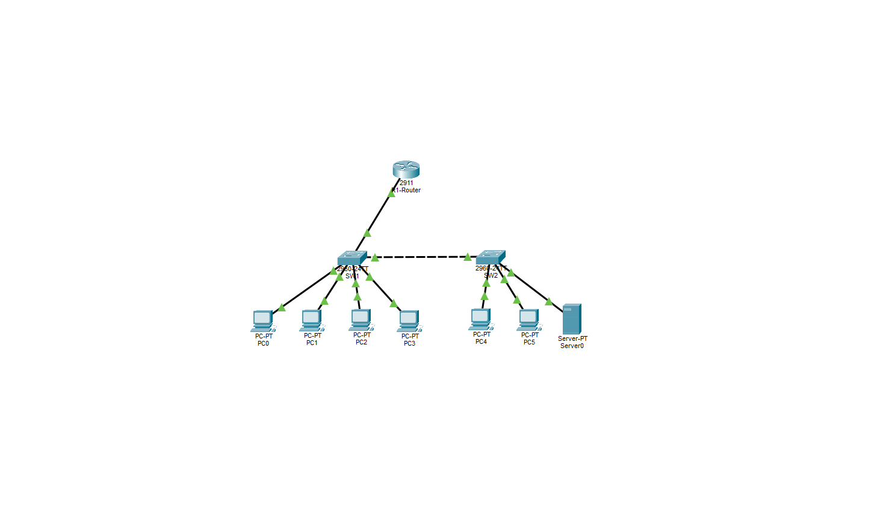
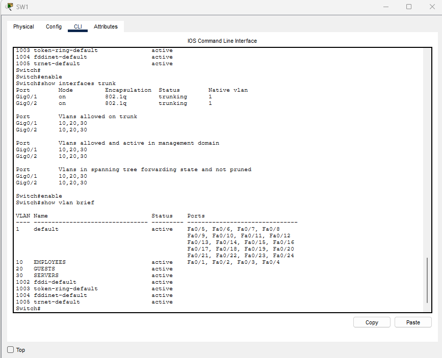
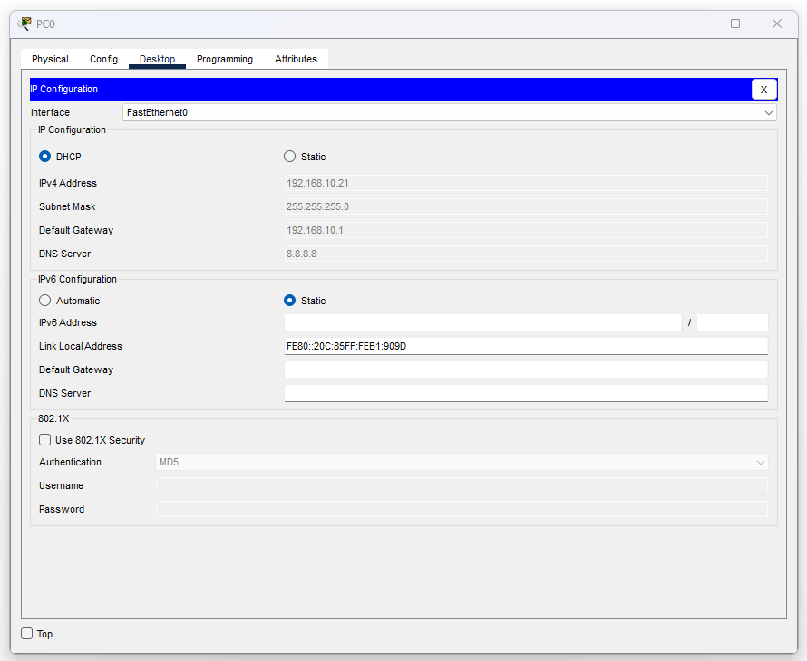
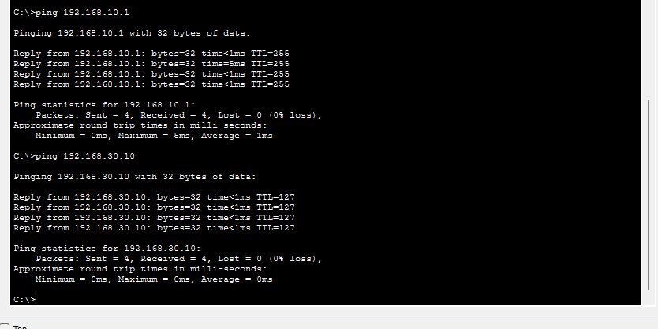
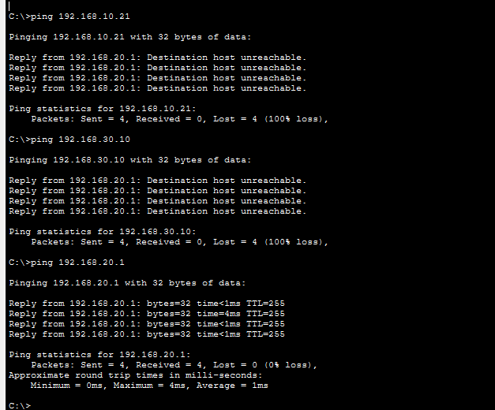

# Small Business Network Simulation

A Cisco Packet Tracer networking and cybersecurity project demonstrating the design, configuration, and security of a simulated small business network.

## Network Topology

The network consists of one Cisco 2911 router, two Cisco 2960 switches, six computers, and one server.

## Technologies & Skills

- Cisco Packet Tracer
- VLAN configuration and network segmentation
- IEEE 802.1Q trunking
- Router-on-a-stick and inter-VLAN routing
- DHCP and static IP addressing
- Extended Access Control Lists (ACLs)
- Network troubleshooting and connectivity testing

## Network Architecture

| VLAN | Department | Network | Default Gateway |
|---|---|---|---|
| 10 | Employees | 192.168.10.0/24 | 192.168.10.1 |
| 20 | Guests | 192.168.20.0/24 | 192.168.20.1 |
| 30 | Servers | 192.168.30.0/24 | 192.168.30.1 |

The employee network contains four computers, the guest network contains two computers, and the server network contains one server.

## VLAN Configuration

Configured VLANs on the switches to logically separate employee, guest, and server traffic. Configured 802.1Q trunk links to carry multiple VLANs between network devices.

## DHCP Configuration

Configured DHCP pools on the router to automatically assign IP addresses to employee and guest devices.

Verified that PC0 received:

- IP Address: 192.168.10.21
- Subnet Mask: 255.255.255.0
- Default Gateway: 192.168.10.1
- DNS Server: 8.8.8.8

The server uses a static IP address of 192.168.30.10.

## Inter-VLAN Routing

Configured router-on-a-stick using three router subinterfaces:

| Router Interface | VLAN | IP Address |
|---|---|---|
| GigabitEthernet0/0.10 | 10 | 192.168.10.1 |
| GigabitEthernet0/0.20 | 20 | 192.168.20.1 |
| GigabitEthernet0/0.30 | 30 | 192.168.30.1 |

## Connectivity Testing

Verified that the employee computer could successfully communicate with its default gateway and the company server.

Both tests completed with 0% packet loss.

## Network Security — ACL Implementation

Implemented an extended IPv4 access control list named `GUEST_SECURITY` on the router.

The ACL blocks guest traffic destined for the employee and server subnets while permitting other traffic.

### Security Test Results

| Source | Destination | Result |
|---|---|---|
| Guest PC4 | Employee PC0 | Blocked |
| Guest PC4 | Server0 | Blocked |
| Guest PC4 | Guest Gateway | Successful |
| Employee PC0 | Server0 | Successful |

These tests demonstrate basic network segmentation and ACL-based traffic filtering.

## Project Files

- `Small-Business-Network.pkt` — Complete Cisco Packet Tracer simulation
- `screenshots/` — Configuration and testing evidence

## How to Run

1. Install Cisco Packet Tracer.
2. Download `Small-Business-Network.pkt`.
3. Open the project in Packet Tracer.
4. Inspect the router and switch configurations.
5. Use the simulated PCs to test connectivity and ACL restrictions.

## What I Learned

Through this project, I gained hands-on experience designing a small business network, configuring VLANs, implementing DHCP and inter-VLAN routing, and applying access control rules.

I also practiced troubleshooting network connectivity and validating security controls through testing.
